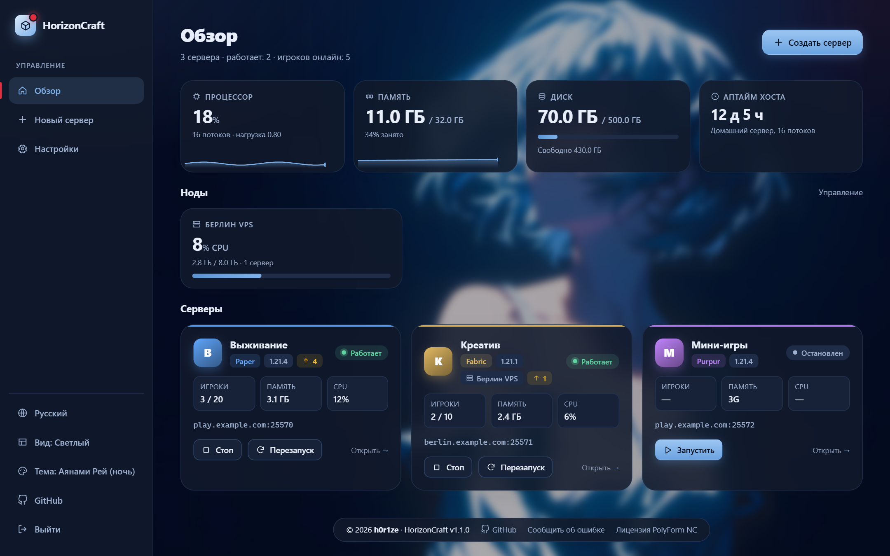
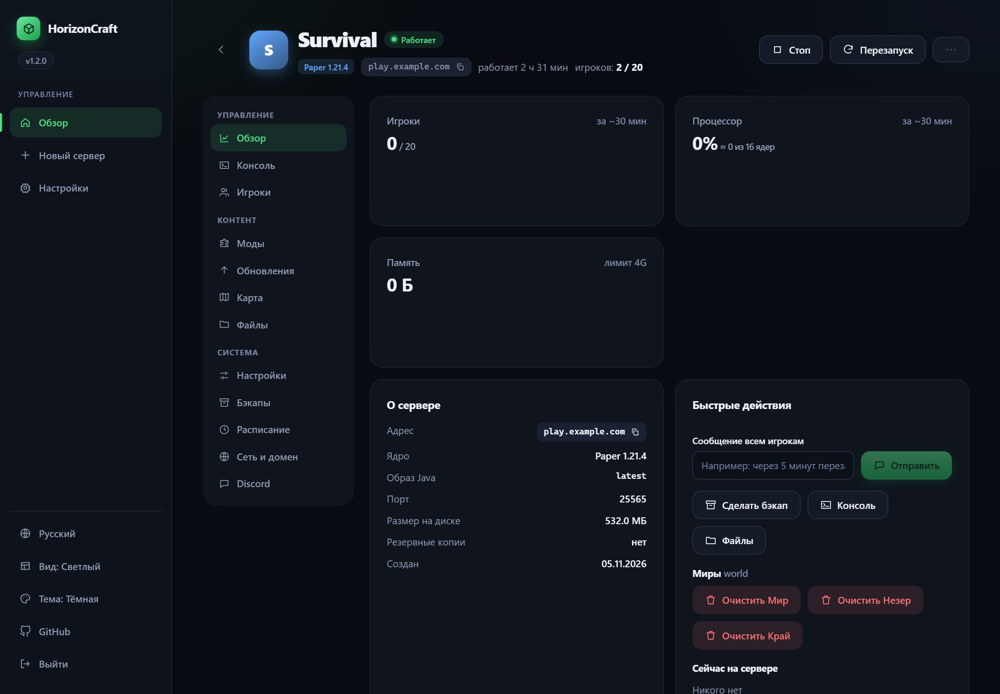
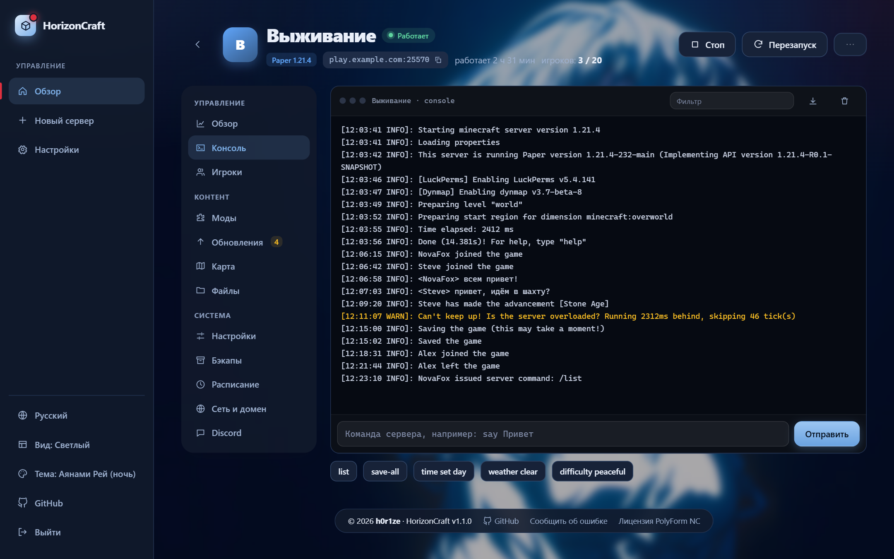
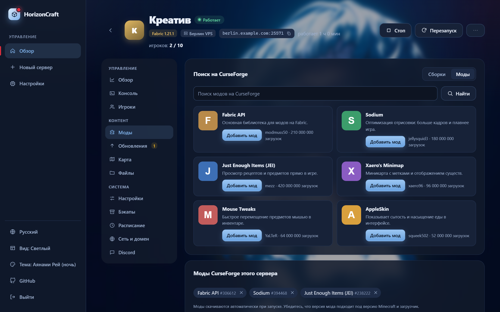
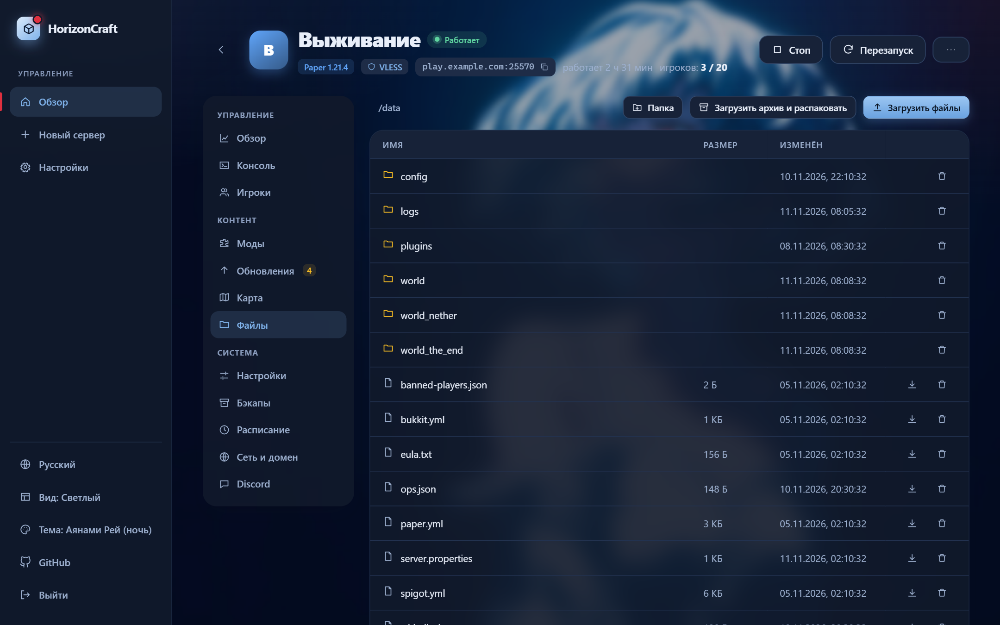
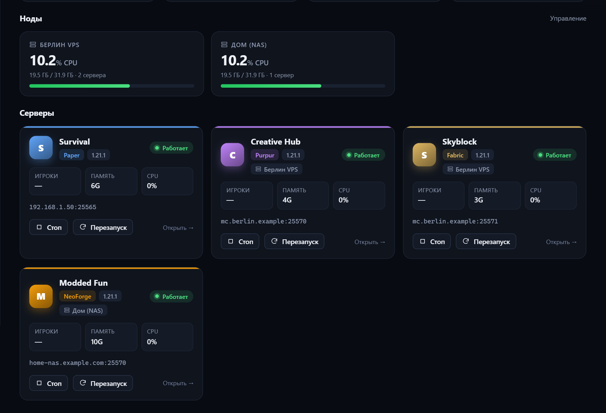
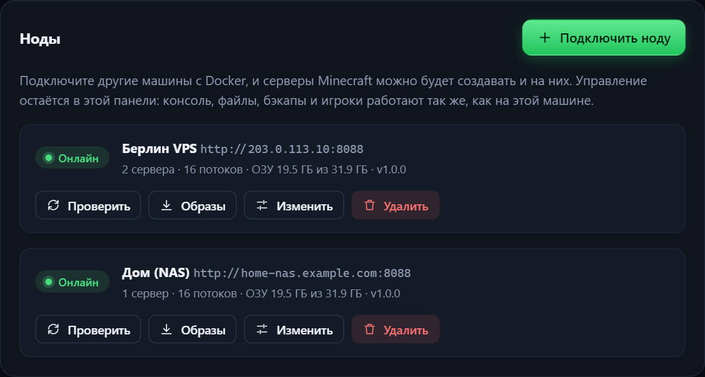
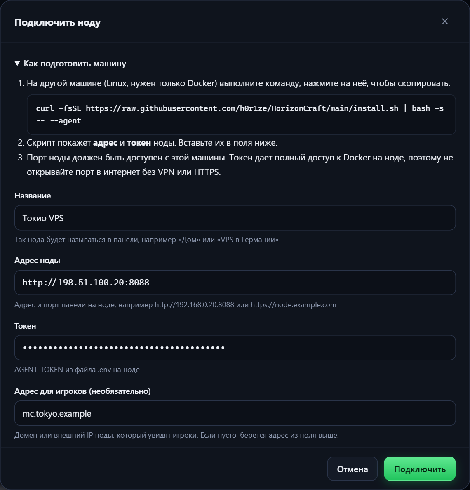
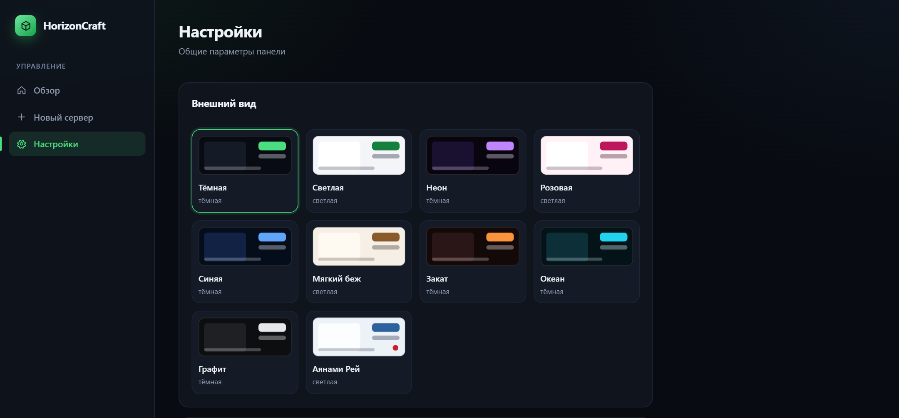

<div align="center">

# 🧱 HorizonCraft

**A web panel for Minecraft servers, powered by Docker.**
Create, configure and maintain multiple servers from your browser. No Java, port or command-line wrestling.

[](https://docs.docker.com/engine/install/)
[](https://nodejs.org/)
[](#-requirements)
[](LICENSE)

**English** · [Русский](README.md)

<br>



</div>

> [!NOTE]
> The panel's user interface is currently in **Russian only**.

---

## ⚡ One-line install

```bash
curl -fsSL https://raw.githubusercontent.com/h0r1ze/HorizonCraft/main/install.sh | bash
```

The script checks for Docker (and offers to install it), downloads the project, creates a `.env` with a random admin password, then builds and starts the panel. When it finishes it prints the URL and the password:

```text
  Done!

  Panel URL:  http://192.168.1.50:8088
  Password:   kP3xV9aQmT7wLz2R   (saved in ~/horizoncraft/.env)
```

<details>
<summary><b>Manual install</b></summary>

```bash
git clone https://github.com/h0r1ze/HorizonCraft.git
cd HorizonCraft
cp .env.example .env
nano .env                  # set ADMIN_PASSWORD and an absolute DATA_DIR
mkdir -p "$(grep ^DATA_DIR= .env | cut -d= -f2)"
docker compose up -d --build
```
</details>

<details>
<summary><b>Installer options</b></summary>

| Variable | Default | Purpose |
|---|---|---|
| `ADMIN_PASSWORD` | random | Admin password (8+ chars, no spaces or `" ' $ # \ `` ` ``) |
| `PANEL_PORT` | `8088` | Web panel port |
| `DATA_DIR` | `<project dir>/data` | Where servers, backups and settings live |
| `TZ` | system timezone | Time zone for schedules and logs |
| `HORIZONCRAFT_DIR` | `~/horizoncraft` | Clone target when installing via `curl` |
| `INSTALL_DOCKER` | unset | `1` installs Docker without asking |

The `--agent` flag turns on agent mode so the machine can be connected as a node, see [Multiple machines](#-multiple-machines-nodes).

Example: `PANEL_PORT=9090 ADMIN_PASSWORD=MySecret123 ./install.sh`
</details>

## ✨ Features

| | |
|---|---|
| 🚀 **Server creation** | Paper, Vanilla, Purpur, Fabric, Forge, NeoForge and one-click CurseForge modpacks. The Java version is picked automatically |
| 🖥️ **Console** | Live server log and command input right in the browser |
| 👥 **Players & chat** | Online list, kick, ban, private messages, whitelist, chat, coloured name prefixes/suffixes |
| 🧩 **Mods** | Search and install from CurseForge and Modrinth |
| 💾 **Backups** | Manual and scheduled backups, retention limit, one-click restore |
| ⏰ **Schedules** | Restart (players are warned 30 seconds ahead), backup, or any command on a schedule |
| 🌍 **Multiple machines (nodes)** | Connect other computers and VPSes and create servers on them. Everything stays in one panel: console, files, backups and players work just like on the main machine |
| 🌐 **Network & domains** | Many servers behind a single port 25565 by domain (via `mc-router`), extra ports for voice chat or Dynmap |
| 📁 **Files** | Browse and edit files, upload, extract and download archives |
| 📦 **Import & clone** | Upload an existing server as an archive, or clone one together with its world |
| 📊 **Monitoring** | CPU, memory and disk usage for the host and each server |
| 🎨 **Looks** | Server covers and icons, coloured MOTD editor, several dark and light panel themes |
| 🔒 **Download proxy** | Fetch modpacks and mods through VLESS (3x-ui subscription or `vless://` link) if sites are blocked where you live |

## 📸 Screenshots

<table>
  <tr>
    <td width="50%"><br><sub><b>Server overview.</b> Players, CPU and memory over 30 minutes, quick actions</sub></td>
    <td width="50%"><br><sub><b>Console.</b> Live log and command input</sub></td>
  </tr>
  <tr>
    <td width="50%"><br><sub><b>New server.</b> Paper, Vanilla, Purpur, Fabric, Forge, NeoForge and CurseForge packs</sub></td>
    <td width="50%"><br><sub><b>Mods.</b> CurseForge search and Modrinth projects</sub></td>
  </tr>
  <tr>
    <td width="50%"><br><sub><b>Network & domain.</b> Ports, domains via mc-router, per-server proxy</sub></td>
    <td width="50%"><br><sub><b>Files.</b> Browse, edit, upload and extract archives</sub></td>
  </tr>
  <tr>
    <td width="50%"><br><sub><b>Nodes on the overview.</b> Load of every machine and their servers in one list</sub></td>
    <td width="50%"><br><sub><b>Settings → Nodes.</b> Status, connection check, image updates</sub></td>
  </tr>
  <tr>
    <td width="50%"><br><sub><b>Connecting a node.</b> Install command, address and token</sub></td>
    <td width="50%"><br><sub><b>Themes.</b> Ten dark and light themes</sub></td>
  </tr>
</table>

> [!NOTE]
> Screenshots use demo data: addresses, covers and the console log text were replaced.

## 📋 Requirements

- **Linux.** Running on Ubuntu 26.04 with Docker 29. Other distributions and arm64 should work but are untested
- **Docker** with the **Docker Compose v2** plugin (the installer can set Docker up for you)
- **RAM:** a small margin for the panel itself plus typically 2–4 GB per Minecraft server, depending on the pack
- **Ports:** `8088` (panel) and server ports (`25565` and up by default)

> [!IMPORTANT]
> Windows and macOS are not supported: the panel drives Docker through `/var/run/docker.sock` and needs real host paths. On Windows, use WSL2 with Docker running inside Linux.

## 🌍 Multiple machines (nodes)

One panel can manage Minecraft servers on several computers: a home server, a NAS, a rented VPS. A node is a regular HorizonCraft install running in **agent mode**. The main panel connects to it with an address and a token and shows its servers next to its own.

**1. On the second machine** (Linux, only Docker is required):

```bash
curl -fsSL https://raw.githubusercontent.com/h0r1ze/HorizonCraft/main/install.sh | bash -s -- --agent
```

At the end the script prints the node's **address** and **token**.

**2. In the main panel:** **Settings → Nodes → Connect a node**, paste the address and token. The panel checks the connection and immediately lists the node's servers.

**3. Create a server on the node:** the **New server** page gets a machine picker. Uploading an existing server archive also works for any node.

<details>
<summary><b>What works on a node and what doesn't</b></summary>

Requests for servers on a node are forwarded to its agent, so everything local servers have works there: console, players, files, backups, schedules, mods, domains, import and cloning (the copy is created on the same node).

- The CurseForge key set in the main panel is passed to nodes automatically.
- **VLESS proxy and "Minecraft images"** are configured per node: the proxy in its own panel, images with the **Images** button in the node list.
- Moving a server from one machine to another is not supported yet: make a backup, download it and upload it to the target node via import.
- If a node is unreachable, its servers stay in the list marked "Node unreachable". The servers themselves keep running on their machine.
- Players connect to the node directly; game traffic does not go through the main panel. For a domain, set **Address for players** in the node form.
- Removing a node from the panel does **not** delete its servers: they keep running and the node can be connected again.
</details>

> [!WARNING]
> A node token gives full control over Docker on that machine. Open the node's port in the firewall **only for the main panel's IP** (`sudo ufw allow from <IP> to any port 8088 proto tcp`). Traffic between panels is plain HTTP, so over the internet connect nodes through a VPN (WireGuard, Tailscale) or put a reverse proxy with HTTPS in front of the agent and use an `https://…` address.

## 🔧 Configuration

Settings live in `.env` next to `docker-compose.yml`. Apply changes with `docker compose up -d`.

| Setting | Description |
|---|---|
| `ADMIN_PASSWORD` | Admin password. **Used only on first start.** Change it later in the panel (Settings → Password) |
| `DATA_DIR` | Absolute path to data. Don't change it after creating servers without moving the folder |
| `PANEL_PORT` | Host port of the web panel |
| `TZ` | Time zone of the panel and servers |
| `AGENT_TOKEN` | Optional. If set (24+ characters), this panel can be connected as a node. Created by `./install.sh --agent` |

To search and install CurseForge modpacks, get a free API key at [console.curseforge.com](https://console.curseforge.com/) and paste it under **Settings → CurseForge**.

## 🔄 Maintenance

| Task | Command |
|---|---|
| Update the panel | `./update.sh` |
| Forgot the password | `./reset-password.sh` (or `./reset-password.sh NewPassword`) |
| View panel logs | `docker compose logs -f panel` |
| Stop the panel | `docker compose stop panel` |
| Back up everything | copy the `DATA_DIR` folder (ideally with servers stopped) |

> [!TIP]
> Updating or restarting the panel does **not** stop your Minecraft servers: they run in separate containers.

<details>
<summary><b>Uninstall</b></summary>

1. Delete (or stop) all servers in the panel.
2. Remove the panel: `docker compose down --rmi all`
3. Optionally delete the data: `rm -rf <DATA_DIR>` (**this permanently deletes worlds and backups**).
4. Leftover helper containers, if any: `docker rm -f mcpanel-router mcpanel-xray mcpanel-proxy-relay` and `docker network rm mcpanel`.
</details>

## 🛠️ How it works

```text
        browser
           │  http://host:8088
           ▼
 ┌────────────────────┐       docker.sock       ┌──────────────────────────────┐
 │  horizoncraft      │ ──────────────────────► │ Docker Engine                │
 │  (Node.js, Preact) │                         │  ├─ mc-xxxxxxxx  (Paper …)   │
 └────────────────────┘                         │  ├─ mc-yyyyyyyy  (Forge …)   │
           │                                    │  ├─ mcpanel-router (domains) │
           ▼                                    │  └─ mcpanel-xray  (proxy)    │
   $DATA_DIR/                                   └──────────────────────────────┘
   ├─ panel.json   settings and server list
   ├─ servers/     worlds and server files
   └─ backups/     backups
```

- Every Minecraft server is a separate [`itzg/minecraft-server`](https://github.com/itzg/docker-minecraft-server) container created and configured by the panel.
- Commands and the player list go through RCON (a unique password is generated per server).
- Backend: Express, `dockerode`, WebSocket. Frontend: Preact + htm with no build step, just plain files in `public/`.

## 🔐 Security

> [!WARNING]
> Access to the panel equals access to Docker on the host, which is effectively root. Treat it accordingly.

- The panel serves **plain HTTP**. Don't expose port `8088` to the internet directly: use a VPN or put a reverse proxy with HTTPS (Caddy, Nginx, Traefik) in front.
- Use a long, unique password and change the installer-generated one after first login.
- `.env` holds the password: it is created with `600` permissions and listed in `.gitignore`. Never publish it.
- Login attempts are rate-limited; sessions last 7 days in an `httpOnly` cookie.

## ❓ FAQ

<details>
<summary><b>The panel page doesn't open</b></summary>

```bash
docker compose ps
docker compose logs --tail 50 panel
```
Make sure `PANEL_PORT` isn't blocked by a firewall.
</details>

<details>
<summary><b>Players can't join from the internet</b></summary>

You need three things: the server port open in the firewall, forwarded on your router to the panel machine, and a public (non-CGNAT) IP from your ISP. Behind CGNAT use a VPN or a tunnel.
</details>

<details>
<summary><b>Port 25565 is taken</b></summary>

It is reserved for `mc-router` as soon as any server has a domain set. Give the other servers a different port on the **Network & domain** tab.
</details>

## 🤝 Contributing

Issues and pull requests are welcome. To run from source you need Node.js 22 and a working Docker:

```bash
npm install
DATA_DIR="$PWD/data" ADMIN_PASSWORD=devpassword node server/index.js
```

## 📄 License

[MIT](LICENSE)
