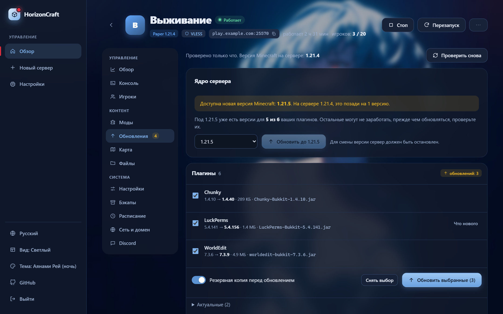
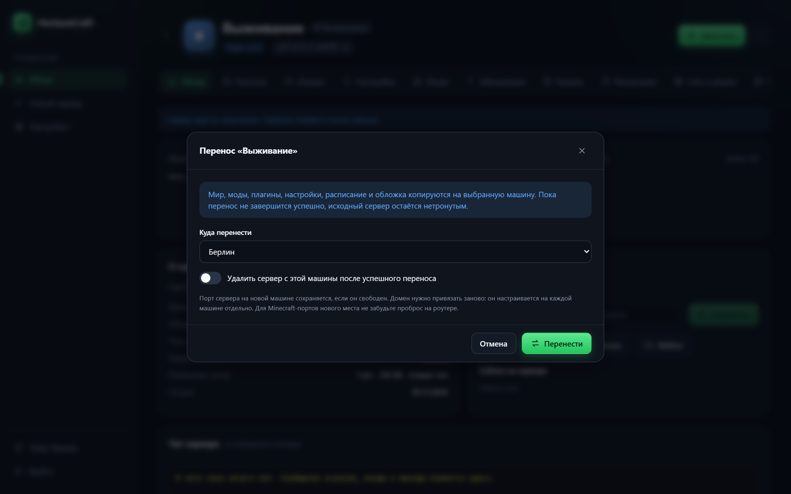
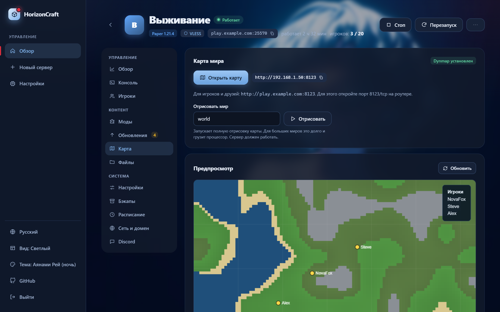
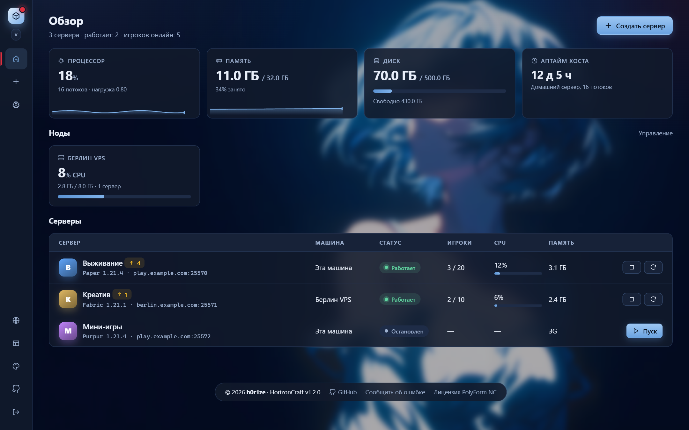
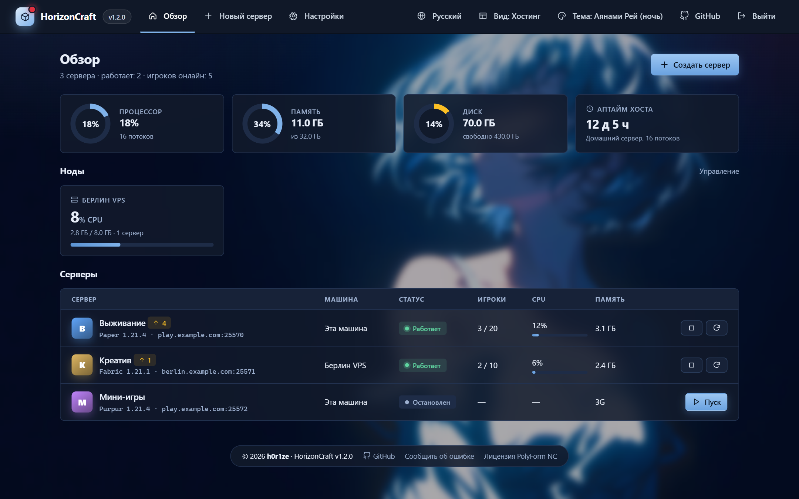
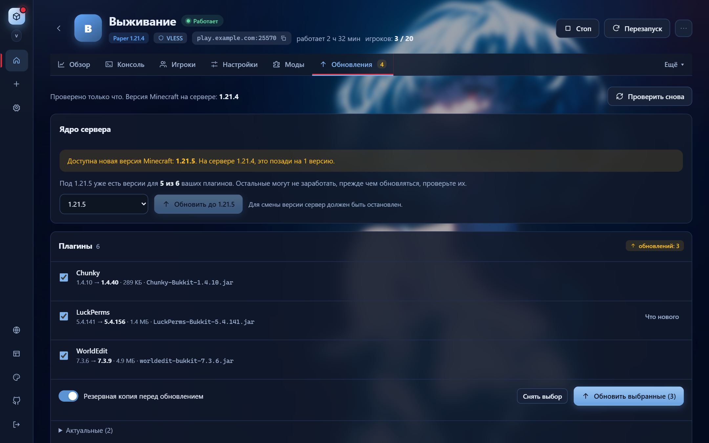
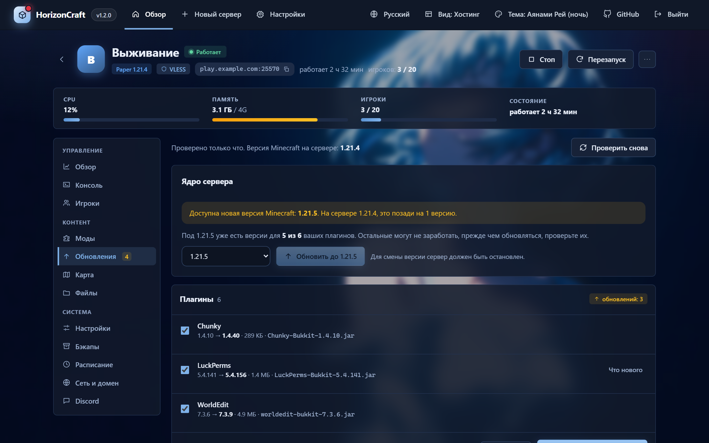

<div align="center">

[](README.md)
[](README.en.md)

# 🧱 HorizonCraft

**A web panel for Minecraft servers, powered by Docker.**
Create, configure and maintain multiple servers from your browser. No Java, port or command-line wrestling.

[](https://docs.docker.com/engine/install/)
[](https://nodejs.org/)
[](#-requirements)
[](LICENSE)

<br>


</div>

> [!NOTE]
> The panel interface is available in **Russian and English**. Switch the language in the side menu or in **Settings**; the choice is remembered in the browser. (Screenshots of newer features below are in English; some older ones still show the Russian interface.)

---

## ⚡ One-line install

<p align="center">
  <picture>
    <source media="(prefers-color-scheme: dark)" srcset="docs/install-en-dark.svg">
    
  </picture>
</p>

**Copy the command** (button on the right of the block) and run it on a Linux server:

```bash
curl -fsSL https://raw.githubusercontent.com/h0r1ze/HorizonCraft/main/install.sh | bash
```

The script checks for Docker (and offers to install it), downloads the project, creates a `.env` with a random admin password, then builds and starts the panel. When it finishes it prints the URL and the password, as in the picture above (the password is saved in `~/horizoncraft/.env`).

<details>
<summary><b>Manual install</b></summary>

```bash
git clone https://github.com/h0r1ze/HorizonCraft.git
cd HorizonCraft
cp .env.example .env
nano .env                  # set ADMIN_PASSWORD and an absolute DATA_DIR
mkdir -p "$(grep ^DATA_DIR= .env | cut -d= -f2)"
docker compose up -d --build
```
</details>

<details>
<summary><b>Installer options</b></summary>

| Variable | Default | Purpose |
|---|---|---|
| `ADMIN_PASSWORD` | random | Admin password (8+ chars, no spaces or `" ' $ # \ `` ` ``) |
| `PANEL_PORT` | `8088` | Web panel port |
| `DATA_DIR` | `<project dir>/data` | Where servers, backups and settings live |
| `TZ` | system timezone | Time zone for schedules and logs |
| `HORIZONCRAFT_DIR` | `~/horizoncraft` | Clone target when installing via `curl` |
| `INSTALL_DOCKER` | unset | `1` installs Docker without asking |

The `--agent` flag turns on agent mode so the machine can be connected as a node, see [Multiple machines](#-multiple-machines-nodes).

Example: `PANEL_PORT=9090 ADMIN_PASSWORD=MySecret123 ./install.sh`
</details>

## ✨ Features

| | |
|---|---|
| 🚀 **Server creation** | Paper, Vanilla, Purpur, Fabric, Forge, NeoForge and one-click CurseForge modpacks. The Java version is picked automatically |
| 🖥️ **Console** | Live server log and command input right in the browser |
| 👥 **Players & chat** | Online list, kick, ban, private messages, whitelist, chat, coloured name prefixes/suffixes |
| 🧩 **Mods** | Search and install from CurseForge and Modrinth |
| 💾 **Backups** | Manual and scheduled backups, retention limit, one-click restore |
| ⏰ **Schedules** | Restart (players are warned 30 seconds ahead), backup, or any command on a schedule |
| 🌍 **Multiple machines (nodes)** | Connect other computers and VPSes and create servers on them. Everything stays in one panel: console, files, backups and players work just like on the main machine |
| 🚚 **Move between machines** | Move a whole server (world, mods, settings) to another machine or node in one click, even a running one: the panel stops it and starts it at the new place |
| 🔄 **Updates** | New Minecraft versions and fresh versions of plugins and mods: files are recognised by hash on Modrinth and updated on selection, with a backup beforehand |
| 🗺️ **World map** | A live Dynmap map in one click: plugin, port and link are set up for you |
| 💬 **Discord status board** | A message with the server status, players, version and address keeps itself up to date in your channel through a webhook, no bot needed. Optional notifications for start, stop and players joining |
| 👥 **Player groups** | ADMIN, MODERATOR, VIP, FLY and HORIZON: ready-made permission sets and a coloured name tag. The permission plugins are installed with one button and a group is picked in the player form |
| 🧹 **World clearing** | The 'Clear the Overworld', 'Clear the Nether' and 'Clear the End' buttons: with a backup before deleting, and the server stops and starts again by itself |
| 🌐 **Two languages** | Russian and English interface, plus a separate language for Discord messages |
| 📋 **Templates** | Save a configured server (settings, mods, configs) as a template and create new servers from it on any machine |
| 🌐 **Network & domains** | Many servers behind a single port 25565 by domain (via `mc-router`), extra ports for voice chat or Dynmap |
| 📁 **Files** | Browse and edit files, upload, extract and download archives |
| 📦 **Import & clone** | Upload an existing server as an archive, or clone one together with its world |
| 📊 **Monitoring** | CPU, memory and disk usage for the host and each server |
| 🎨 **Looks** | Three interface layouts to choose from (Graphite, Light, Hosting) and ten colour themes (six dark and four light, listed in separate groups), server covers and icons, coloured MOTD editor |
| 🔒 **Download proxy** | Fetch modpacks and mods through VLESS (3x-ui subscription or `vless://` link) if sites are blocked where you live |

## 📸 Screenshots

<table>
  <tr>
    <td width="50%"><br><sub><b>Server overview.</b> Players, CPU and memory over 30 minutes, quick actions</sub></td>
    <td width="50%"><br><sub><b>Console.</b> Live log and command input</sub></td>
  </tr>
  <tr>
    <td width="50%"><br><sub><b>New server.</b> Paper, Vanilla, Purpur, Fabric, Forge, NeoForge and CurseForge packs</sub></td>
    <td width="50%"><br><sub><b>Mods.</b> CurseForge search and Modrinth projects</sub></td>
  </tr>
  <tr>
    <td width="50%"><br><sub><b>Network & domain.</b> Ports, domains via mc-router, per-server proxy</sub></td>
    <td width="50%"><br><sub><b>Files.</b> Browse, edit, upload and extract archives</sub></td>
  </tr>
  <tr>
    <td width="50%"><br><sub><b>Nodes on the overview.</b> Load of every machine and their servers in one list</sub></td>
    <td width="50%"><br><sub><b>Settings → Nodes.</b> Status, connection check, image updates</sub></td>
  </tr>
  <tr>
    <td width="50%"><br><sub><b>Connecting a node.</b> Install command, address and token</sub></td>
    <td width="50%"><br><sub><b>Themes.</b> Six dark and four light themes, split into groups</sub></td>
  </tr>
  <tr>
    <td width="50%"><br><sub><b>Updates.</b> New Minecraft versions and fresh plugin and mod builds</sub></td>
    <td width="50%"><br><sub><b>Moving a server.</b> To another machine or node, even a running one</sub></td>
  </tr>
  <tr>
    <td width="50%"><br><sub><b>World map.</b> Dynmap in one click</sub></td>
    <td width="50%"><br><sub><b>Templates.</b> A new server from a saved template</sub></td>
  </tr>
  <tr>
    <td width="50%"><br><sub><b>Discord.</b> Paste the webhook URL, choose the address players see (a domain, a public IP or a LAN address) and, if needed, a proxy</sub></td>
    <td width="50%"><br><sub><b>Status board.</b> Refresh rate, event notifications, proxy and a preview of the message</sub></td>
  </tr>
  <tr>
    <td width="50%"><br><sub><b>Player groups.</b> Five ready-made groups and what each one can do</sub></td>
    <td width="50%"><br><sub><b>Group and name tag.</b> Pick a group in the player form with a large in-game preview</sub></td>
  </tr>
  <tr>
    <td width="50%"><br><sub><b>World clearing.</b> Three buttons in Quick actions, with the size of each dimension</sub></td>
    <td width="50%"><br><sub><b>Confirmation.</b> A backup by default; the server stops and starts again automatically</sub></td>
  </tr>
  <tr>
    <td colspan="2" align="center"><br><sub><b>Interface language.</b> Russian or English, switched in one click</sub></td>
  </tr>
</table>

> [!NOTE]
> Screenshots use demo data: addresses, covers and the console log text were replaced.

## 📋 Requirements

- **Linux.** Running on Ubuntu 26.04 with Docker 29. Other distributions and arm64 should work but are untested
- **Docker** with the **Docker Compose v2** plugin (the installer can set Docker up for you)
- **RAM:** a small margin for the panel itself plus typically 2–4 GB per Minecraft server, depending on the pack
- **Ports:** `8088` (panel) and server ports (`25565` and up by default)

> [!IMPORTANT]
> Windows and macOS are not supported: the panel drives Docker through `/var/run/docker.sock` and needs real host paths. On Windows, use WSL2 with Docker running inside Linux.

## 🌍 Multiple machines (nodes)

One panel can manage Minecraft servers on several computers: a home server, a NAS, a rented VPS. A node is a regular HorizonCraft install running in **agent mode**. The main panel connects to it with an address and a token and shows its servers next to its own.

**1. On the second machine** (Linux, only Docker is required):

```bash
curl -fsSL https://raw.githubusercontent.com/h0r1ze/HorizonCraft/main/install.sh | bash -s -- --agent
```

At the end the script prints the node's **address** and **token**.

**2. In the main panel:** **Settings → Nodes → Connect a node**, paste the address and token. The panel checks the connection and immediately lists the node's servers.

**3. Create a server on the node:** the **New server** page gets a machine picker. Uploading an existing server archive also works for any node.

<details>
<summary><b>What works on a node and what doesn't</b></summary>

Requests for servers on a node are forwarded to its agent, so everything local servers have works there: console, players, files, backups, schedules, mods, domains, import and cloning (the copy is created on the same node).

- The CurseForge key set in the main panel is passed to nodes automatically.
- **VLESS proxy and "Minecraft images"** are configured per node: the proxy in its own panel, images with the **Images** button in the node list.
- Servers can be moved between machines, see [Moving a server](#-moving-a-server-between-machines).
- If a node is unreachable, its servers stay in the list marked "Node unreachable". The servers themselves keep running on their machine.
- Players connect to the node directly; game traffic does not go through the main panel. For a domain, set **Address for players** in the node form.
- Removing a node from the panel does **not** delete its servers: they keep running and the node can be connected again.
</details>

> [!WARNING]
> A node token gives full control over Docker on that machine. Open the node's port in the firewall **only for the main panel's IP** (`sudo ufw allow from <IP> to any port 8088 proto tcp`). Traffic between panels is plain HTTP, so over the internet connect nodes through a VPN (WireGuard, Tailscale) or put a reverse proxy with HTTPS in front of the agent and use an `https://…` address.

## 🖼️ Interface layouts

**Settings → Interface layout** switches the page layout. Colours come from the theme, so layout and theme can be combined freely. The choice is remembered in the browser.

<table>
  <tr>
    <td width="33%"><br><sub><b>A · Graphite.</b> Narrow icon rail, servers as rows, grouped server tabs with rare ones under "More"</sub></td>
    <td width="33%"><br><sub><b>B · Light.</b> Large server cards and room to breathe. Server sections in a vertical three-group menu</sub></td>
    <td width="33%"><br><sub><b>C · Hosting.</b> Top navigation, servers as a table, ring gauges for host resources</sub></td>
  </tr>
  <tr>
    <td></td>
    <td></td>
    <td></td>
  </tr>
</table>

On a phone the side and top menus are replaced by a bottom bar, and server sections become a scrollable strip.

## 🚚 Moving a server between machines

Server page **"⋯" menu → Move to another machine** (shown once at least one node is connected). You can move from the main machine to a node, from a node to the main machine, and between nodes.

1. Choose the destination. If the server is running, the panel stops it (the world is saved) and, if you wish, starts it at the new place.
2. Server files are streamed as `tar.gz` from one machine to the other through the main panel, with no temporary files on its disk.
3. The new machine gets a server with the same settings: type and version, memory, properties, mod lists, schedule, player tags, cover and icon, world map.

Until the move succeeds the source server stays untouched. On an error at any step it is started again and the data received on the new machine is discarded. By default the source server **stays** (stopped) on the old machine: delete it once you are sure everything works, or turn on "Delete after a successful move".

<details>
<summary><b>What is not moved</b></summary>

- **The domain.** It is configured per machine: set it up again on the "Network & domain" tab.
- **The server proxy.** Proxy nodes are stored in each machine's panel.
- **The port** is kept if free on the new machine, otherwise the next free one is used.
- Servers containing symbolic links are not moved (such archives are rejected for safety).
</details>

## 🔄 Updates

The **Updates** tab on a server page:

- **Core.** If the server is pinned to a Minecraft version and newer ones exist, the panel says so and offers to update. A backup can be created before the version change. For a "latest" server a restart is enough.
- **Plugins and mods.** Files in `plugins/` (Paper, Purpur) or `mods/` (Fabric, Forge, NeoForge) are matched against [Modrinth](https://modrinth.com) by hash, so it does not matter where they came from. Pick the updates and press **Update selected**: the file is downloaded, verified by checksum and replaces the old one.
- For a pinned server it shows how many of your plugins and mods already have builds for the newest Minecraft version.
- Every 6 hours the panel checks servers by itself and puts a badge with the number of available updates on the server card.

Files that are not on Modrinth (built by hand or taken from other sites) are listed separately and are not updated automatically.

## 🗺️ World map

The **Map** tab (Paper and Purpur servers) enables [Dynmap](https://modrinth.com/plugin/dynmap) in one click: the panel adds the plugin to the Modrinth auto-install list, picks a free port for the map page (from 8123–8199) and shows a link and a preview. The plugin is downloaded on the next server start. **Render** starts a full render of the world. To share the map with friends, forward the shown port on your router.

## 💬 Discord status board

The **Discord** tab (under "System") turns a single message in your channel into a live status board: online or offline, player count and names, version, address, uptime and memory. No bot is needed, just a webhook.

1. In Discord open the channel: **Channel settings → Integrations → Webhooks → New Webhook → Copy Webhook URL**.
2. In the panel open the server → **Discord**, paste the URL and click **Connect**.
3. Choose the **address players see**: ready-made options (the server domain, the machine's public address, the LAN address) fill in with one click, or type your own: a domain, a public IP or a LAN address, with or without a port.

The panel edits the same message instead of flooding the channel. It refreshes every 30 seconds, 1, 2 or 5 minutes, and a start, a stop or a change in player count reaches the board almost immediately. Optionally, separate messages announce events, each with its own switch: 'server started' (off by default), 'stopped', 'crashed', 'player joined or left'. The same server-state event arrives at most once every 10 minutes, so restarts do not clutter the channel. **Send again** deletes the old message and posts a fresh one (for example, to pin it).

- The webhook URL is a secret: the panel never shows it in the interface and leaves it out of clones, migrations and templates. `@everyone` mentions in messages are disabled.
- Discord is blocked by some providers. The tab has its own **Send through a proxy** block: turn it on and pick a node from those added under **Settings → "Прокси для серверов"** (a 3x-ui subscription, a `vless://` link or your own proxy). Only this board's requests use it; the rest of the traffic is unchanged. **Check connection** shows at once whether Discord opens and accepts the webhook. For servers on nodes, the nodes of the machine that runs the server are used.
- If the panel stops, the message stops updating; the timestamp in it shows this.

## 👥 Player groups

The **Players → Player groups** block gives you five ready-made groups. Permissions come from [LuckPerms](https://modrinth.com/plugin/luckperms); the `/fly` and `/tpa` commands come from [EssentialsX](https://modrinth.com/plugin/essentialsx). The panel downloads both plugins from Modrinth, creates the groups and assigns them to players.

| Group | Name tag | What it can do |
|---|---|---|
| **ADMIN** | red `[ADMIN]` | Full access: all server and plugin commands |
| **MODERATOR** | blue `[MODERATOR]` | Kick, ban (including temporary), mute, teleport to players and players to you, vanish, inventory viewing, flight. Not allowed: giving items, changing game mode, OP, stopping the server |
| **VIP** | yellow `[VIP]` | Flight and teleport |
| **FLY** | green `[FLY]` | Flight only |
| **HORIZON** | grey `[HORIZON]` | A regular player with no privileges, teleport. Players with no group assigned get the same permissions |

1. Open the server → **Players** → **Player groups**. If the server runs Vanilla, click **Switch to Paper**: the world, settings and players are kept.
2. Click **Enable groups** and restart the server. Permissions are applied by themselves after it starts.
3. In the **Name tags** form enter a nickname and pick a group. The group's name tag is filled in automatically. You can assign a player in advance: the group is applied when they join.

- Teleport for VIP and HORIZON works by request: `/tpa`, `/tpahere` and `/tpaccept` by the other player (FLY has no teleport). A direct `/tp` is only available to ADMIN and MODERATOR.
- **Chat without brackets.** The `<` `>` brackets are part of Minecraft's standard chat format. The **Chat without brackets** switch in the groups card installs the EssentialsX chat module and Vault and passes the players' name tags into LuckPerms; the format becomes `[ADMIN] Nick: message`. The tag colour is kept. A server restart is needed after enabling. The panel's Chat tab understands both formats.
- Permissions are bound to the player's UUID, so changing the nickname's letter case or assigning again duplicates nothing.
- EssentialsX officially supports Minecraft versions with a small delay. On the very newest versions the log may show an "unsupported server version" warning; the plugin still loads.

### If the plugins do not start

The Minecraft server does not run as root, so the `plugins` folder must belong to its user. If an earlier panel version created it, the plugins get disabled with an `AccessDeniedException`, and commands like `list` and `weather` answer "unexpected error". The panel fixes the permissions by itself when you open the **Players** tab and suggests restarting the server. On Paper and Purpur it also runs vanilla commands (`list`, `kick`, `ban`, `tell`, `gamemode`, `weather`, `time` and others) with the `minecraft:` prefix so plugins cannot intercept them.

## 🧹 World clearing

On the server overview, **Quick actions** has the **Clear the Overworld**, **Clear the Nether** and **Clear the End** buttons. Only the chunk data of the chosen dimension is deleted: inventories, achievements, settings and the other dimensions are untouched. The server generates the dimension anew on the next start.

- A backup is made before clearing by default (you can turn it off in the confirmation window).
- If the server is running, the panel stops it and starts it again after clearing.
- The Overworld has a **new seed** option: `level.dat` is deleted, so the world is created with a different seed, and time, weather and game rules are reset.
- Both folder layouts are supported: the new one (`world/dimensions/minecraft/…`) and the older one (`world/region`, `DIM-1`, `DIM1`, `world_nether`, `world_the_end`).

## 🌐 Interface language

The panel speaks Russian and English. Switch it with the button in the side menu or in **Settings → Language**. The browser language is used by default. The language of Discord messages is chosen separately on the **Discord** tab.

## 📋 Server templates

**"⋯" menu on a server page → Save as template.** A template holds the type and version, memory, `server.properties` values, Modrinth and CurseForge mod lists, the schedule and, optionally, the `mods`, `plugins` and `config` folders. The world, player tags and domain are not saved. On **New server** pick a template, give it a name, and the server appears on the chosen machine (including a node) already with the right plugins. Templates are managed under **Settings → Server templates**.

## 🔧 Configuration

Settings live in `.env` next to `docker-compose.yml`. Apply changes with `docker compose up -d`.

| Setting | Description |
|---|---|
| `ADMIN_PASSWORD` | Admin password. **Used only on first start.** Change it later in the panel (Settings → Password) |
| `DATA_DIR` | Absolute path to data. Don't change it after creating servers without moving the folder |
| `PANEL_PORT` | Host port of the web panel |
| `TZ` | Time zone of the panel and servers |
| `AGENT_TOKEN` | Optional. If set (24+ characters), this panel can be connected as a node. Created by `./install.sh --agent` |

To search and install CurseForge modpacks, get a free API key at [console.curseforge.com](https://console.curseforge.com/) and paste it under **Settings → CurseForge**.

## 🔄 Maintenance

| Task | Command |
|---|---|
| Update the panel | `./update.sh` |
| Forgot the password | `./reset-password.sh` (or `./reset-password.sh NewPassword`) |
| View panel logs | `docker compose logs -f panel` |
| Stop the panel | `docker compose stop panel` |
| Back up everything | copy the `DATA_DIR` folder (ideally with servers stopped) |

> [!TIP]
> Updating or restarting the panel does **not** stop your Minecraft servers: they run in separate containers.

<details>
<summary><b>Uninstall</b></summary>

1. Delete (or stop) all servers in the panel.
2. Remove the panel: `docker compose down --rmi all`
3. Optionally delete the data: `rm -rf <DATA_DIR>` (**this permanently deletes worlds and backups**).
4. Leftover helper containers, if any: `docker rm -f mcpanel-router mcpanel-xray mcpanel-proxy-relay` and `docker network rm mcpanel`.
</details>

## 🛠️ How it works

```text
        browser
           │  http://host:8088
           ▼
 ┌────────────────────┐       docker.sock       ┌──────────────────────────────┐
 │  horizoncraft      │ ──────────────────────► │ Docker Engine                │
 │  (Node.js, Preact) │                         │  ├─ mc-xxxxxxxx  (Paper …)   │
 └────────────────────┘                         │  ├─ mc-yyyyyyyy  (Forge …)   │
           │                                    │  ├─ mcpanel-router (domains) │
           ▼                                    │  └─ mcpanel-xray  (proxy)    │
   $DATA_DIR/                                   └──────────────────────────────┘
   ├─ panel.json   settings and server list
   ├─ servers/     worlds and server files
   └─ backups/     backups
```

- Every Minecraft server is a separate [`itzg/minecraft-server`](https://github.com/itzg/docker-minecraft-server) container created and configured by the panel.
- Commands and the player list go through RCON (a unique password is generated per server).
- Backend: Express, `dockerode`, WebSocket. Frontend: Preact + htm with no build step, just plain files in `public/`.

## 🔐 Security

> [!WARNING]
> Access to the panel equals access to Docker on the host, which is effectively root. Treat it accordingly.

- The panel serves **plain HTTP**. Don't expose port `8088` to the internet directly: use a VPN or put a reverse proxy with HTTPS (Caddy, Nginx, Traefik) in front.
- Use a long, unique password and change the installer-generated one after first login.
- `.env` holds the password: it is created with `600` permissions and listed in `.gitignore`. Never publish it.
- Login attempts are rate-limited; sessions last 7 days in an `httpOnly` cookie.

## ❓ FAQ

<details>
<summary><b>The panel page doesn't open</b></summary>

```bash
docker compose ps
docker compose logs --tail 50 panel
```
Make sure `PANEL_PORT` isn't blocked by a firewall.
</details>

<details>
<summary><b>Players can't join from the internet</b></summary>

You need three things: the server port open in the firewall, forwarded on your router to the panel machine, and a public (non-CGNAT) IP from your ISP. Behind CGNAT use a VPN or a tunnel.
</details>

<details>
<summary><b>Port 25565 is taken</b></summary>

It is reserved for `mc-router` as soon as any server has a domain set. Give the other servers a different port on the **Network & domain** tab.
</details>

## 🤝 Contributing

Issues and pull requests are welcome. To run from source you need Node.js 22 and a working Docker:

```bash
npm install
DATA_DIR="$PWD/data" ADMIN_PASSWORD=devpassword node server/index.js
```

## 📄 License

[MIT](LICENSE)

---

<div align="center">

[](README.md)
[](README.en.md)

</div>
