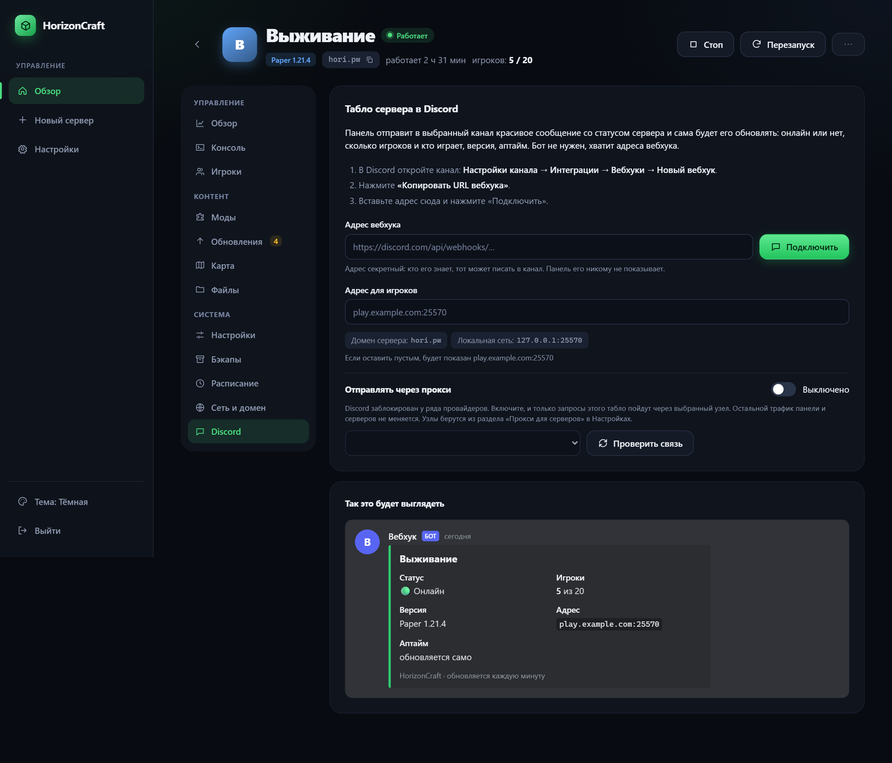
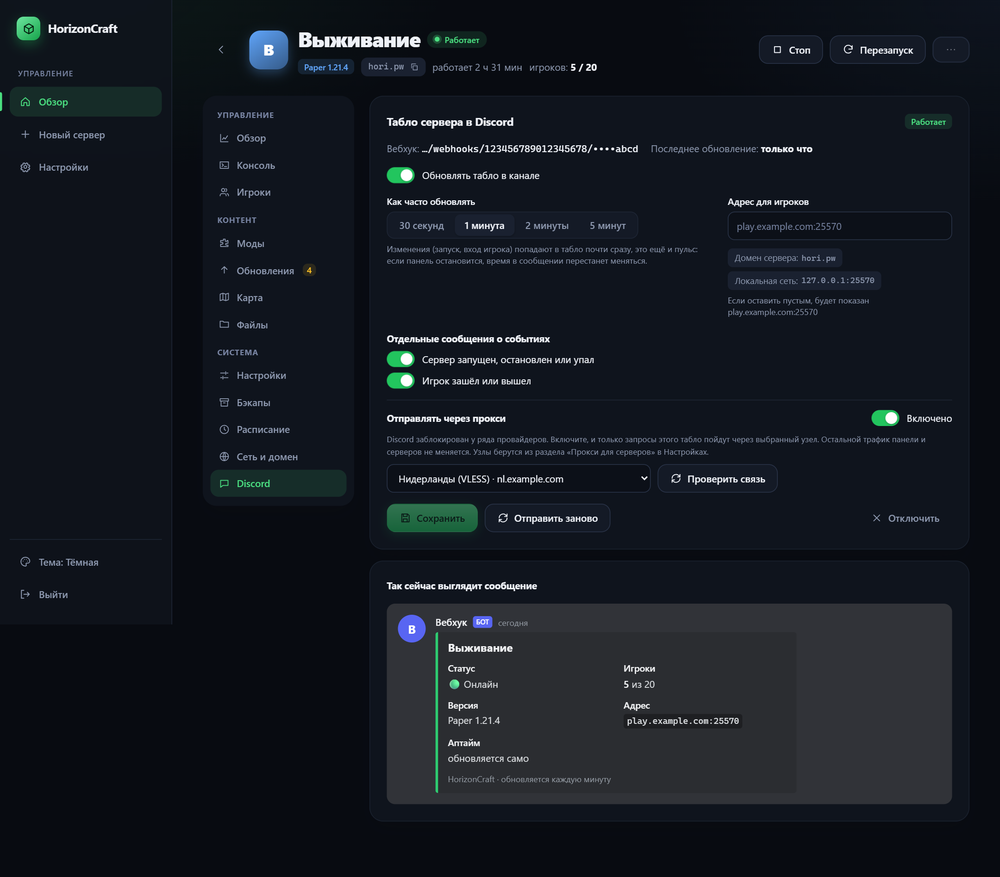
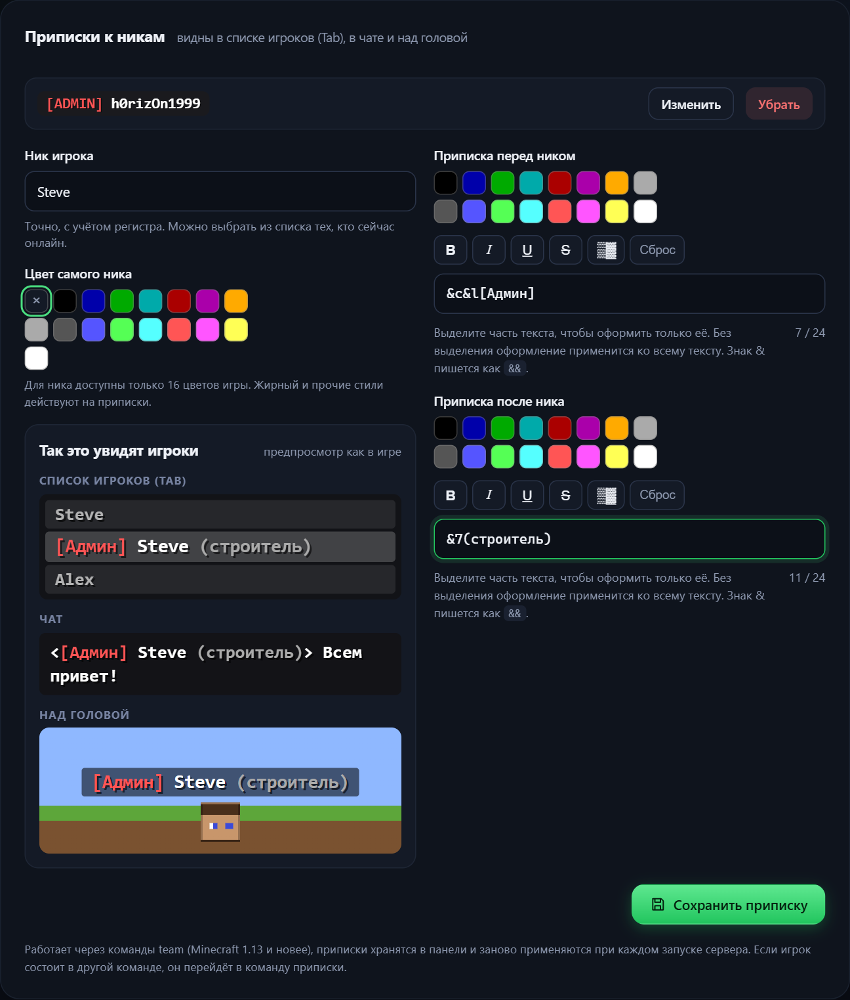

<div align="center">

[](README.md)
[](README.en.md)

# 🧱 HorizonCraft

**Веб-панель для Minecraft-серверов на Docker.**
Создавайте, настраивайте и обслуживайте несколько серверов из браузера: без возни с Java, портами и командной строкой.

[](https://docs.docker.com/engine/install/)
[](https://nodejs.org/)
[](#-требования)
[](LICENSE)

<br>


</div>

---

## ⚡ Установка одной командой

```bash
curl -fsSL https://raw.githubusercontent.com/h0r1ze/HorizonCraft/main/install.sh | bash
```

Скрипт сам проверит Docker (при необходимости предложит его установить), скачает проект, создаст `.env` со случайным паролем, соберёт и запустит панель. В конце он покажет адрес и пароль:

```text
  Готово!

  Адрес панели:  http://192.168.1.50:8088
  Пароль:        kP3xV9aQmT7wLz2R   (сохранён в ~/horizoncraft/.env)
```

Откройте адрес в браузере, войдите и создайте первый сервер.

<details>
<summary><b>Установка вручную (без скрипта)</b></summary>

```bash
git clone https://github.com/h0r1ze/HorizonCraft.git
cd HorizonCraft
cp .env.example .env
nano .env                  # задайте ADMIN_PASSWORD и абсолютный путь DATA_DIR
mkdir -p "$(grep ^DATA_DIR= .env | cut -d= -f2)"
docker compose up -d --build
```
</details>

<details>
<summary><b>Параметры установщика</b></summary>

Переменные окружения, которые понимает `install.sh`:

| Переменная | По умолчанию | Назначение |
|---|---|---|
| `ADMIN_PASSWORD` | случайный | Пароль администратора (от 8 символов, без пробелов и `" ' $ # \ `` ` ``) |
| `PANEL_PORT` | `8088` | Порт веб-панели |
| `DATA_DIR` | `<папка проекта>/data` | Где хранить серверы, бэкапы и настройки |
| `TZ` | часовой пояс системы | Время в расписании и логах |
| `HORIZONCRAFT_DIR` | `~/horizoncraft` | Куда клонировать при установке через `curl` |
| `INSTALL_DOCKER` | не задано | `1` — установить Docker без вопросов |

Параметр `--agent` включает режим агента для подключения машины как ноды, см. [Несколько машин](#-несколько-машин-ноды).

Пример: `PANEL_PORT=9090 ADMIN_PASSWORD=MySecret123 ./install.sh`
</details>

## ✨ Возможности

| | |
|---|---|
| 🚀 **Создание серверов** | Paper, Vanilla, Purpur, Fabric, Forge, NeoForge и готовые сборки CurseForge в один клик. Версия Java подбирается автоматически |
| 🖥️ **Консоль** | Журнал сервера в реальном времени и отправка команд прямо из браузера |
| 👥 **Игроки и чат** | Список онлайн, кик, бан, личные сообщения, белый список, чат, цветные префиксы и суффиксы ников |
| 🧩 **Моды** | Поиск и установка из CurseForge и Modrinth |
| 💾 **Бэкапы** | Ручные и автоматические копии, хранение нужного количества, восстановление одним нажатием |
| ⏰ **Расписание** | Перезапуск (с предупреждением игрокам за 30 секунд), бэкап или любая команда по расписанию |
| 🌍 **Несколько машин (ноды)** | Подключайте другие компьютеры и VPS и создавайте серверы на них. Всё управление остаётся в одной панели: консоль, файлы, бэкапы и игроки работают так же, как на основной машине |
| 🚚 **Перенос между машинами** | Переносите сервер целиком (мир, моды, настройки) на другую машину или ноду в один клик, даже работающий: панель сама остановит его и запустит на новом месте |
| 🔄 **Обновления** | Новая версия Minecraft и свежие версии плагинов и модов: файлы опознаются по хэшу в Modrinth и обновляются выбранными, с резервной копией перед обновлением |
| 🗺️ **Карта мира** | Живая карта на Dynmap включается одной кнопкой: плагин, порт и ссылка настраиваются сами |
| 💬 **Табло в Discord** | Сообщение со статусом сервера, игроками, версией и адресом само обновляется в вашем канале через вебхук, бот не нужен. По желанию приходят уведомления о запуске, остановке и входе игроков |
| 📋 **Шаблоны** | Сохраните настроенный сервер (настройки, моды, конфиги) как шаблон и создавайте по нему новые серверы на любой машине |
| 🌐 **Сеть и домены** | Несколько серверов на одном порту 25565 по разным доменам (через `mc-router`), дополнительные порты для голосового чата и Dynmap |
| 📁 **Файлы** | Просмотр и правка файлов, загрузка, распаковка и скачивание архивов |
| 📦 **Импорт и клонирование** | Загрузите готовый сервер архивом или склонируйте существующий вместе с миром |
| 📊 **Мониторинг** | Нагрузка на процессор, память и диск хоста и каждого сервера |
| 🎨 **Оформление** | Три вида интерфейса на выбор (Графит, Светлый, Хостинг) и десять цветовых тем (шесть тёмных и четыре светлые, в списке они разделены), обложки и значки серверов, цветное описание (MOTD) с редактором форматирования |
| 🔒 **Прокси для загрузок** | Скачивание сборок и модов через VLESS (подписка 3x-ui или ссылка `vless://`), если сайты недоступны в вашей стране |

> [!NOTE]
> Интерфейс панели пока только на русском языке.

## 📸 Скриншоты

<table>
  <tr>
    <td width="50%"><br><sub><b>Обзор сервера.</b> Игроки, процессор и память за 30 минут, быстрые действия</sub></td>
    <td width="50%"><br><sub><b>Консоль.</b> Журнал в реальном времени и отправка команд</sub></td>
  </tr>
  <tr>
    <td width="50%"><br><sub><b>Новый сервер.</b> Paper, Vanilla, Purpur, Fabric, Forge, NeoForge и сборки CurseForge</sub></td>
    <td width="50%"><br><sub><b>Моды.</b> Поиск на CurseForge и установка проектов Modrinth</sub></td>
  </tr>
  <tr>
    <td width="50%"><br><sub><b>Сеть и домен.</b> Порты, домены через mc-router, прокси для сервера</sub></td>
    <td width="50%"><br><sub><b>Файлы.</b> Просмотр, правка, загрузка и распаковка архивов</sub></td>
  </tr>
  <tr>
    <td width="50%"><br><sub><b>Ноды на обзоре.</b> Нагрузка каждой машины и серверы на них в одном списке</sub></td>
    <td width="50%"><br><sub><b>Настройки → Ноды.</b> Статус, проверка связи, обновление образов</sub></td>
  </tr>
  <tr>
    <td width="50%"><br><sub><b>Подключение ноды.</b> Команда установки, адрес и токен</sub></td>
    <td width="50%"><br><sub><b>Темы.</b> Шесть тёмных и четыре светлые темы, в списке они разделены на группы</sub></td>
  </tr>
  <tr>
    <td width="50%"><br><sub><b>Обновления.</b> Новая версия Minecraft и свежие версии плагинов и модов</sub></td>
    <td width="50%"><br><sub><b>Перенос сервера.</b> На другую машину или ноду, даже работающего</sub></td>
  </tr>
  <tr>
    <td width="50%"><br><sub><b>Карта мира.</b> Dynmap включается одной кнопкой</sub></td>
    <td width="50%"><br><sub><b>Шаблоны.</b> Новый сервер по сохранённому шаблону</sub></td>
  </tr>
  <tr>
    <td width="50%"><br><sub><b>Discord.</b> Вставьте адрес вебхука, выберите адрес для игроков (домен, внешний IP, локальный) и при необходимости прокси</sub></td>
    <td width="50%"><br><sub><b>Табло в Discord.</b> Частота обновления, уведомления о событиях, прокси и макет сообщения</sub></td>
  </tr>
  <tr>
    <td colspan="2" align="center"><br><sub><b>Приписки к никам.</b> Крупный предпросмотр как в игре: список игроков (Tab), чат и ник над головой</sub></td>
  </tr>
</table>

> [!NOTE]
> Скриншоты сделаны на демонстрационных данных: адреса, обложки и текст журнала в консоли заменены.

## 📋 Требования

- **Linux.** Панель работает на Ubuntu 26.04 с Docker 29. На других дистрибутивах и на arm64 должна работать, но не проверялась
- **Docker** с плагином **Docker Compose v2** (установщик поставит Docker сам, если разрешите)
- **ОЗУ:** небольшой запас на саму панель плюс обычно 2–4 ГБ на каждый Minecraft-сервер (зависит от сборки)
- **Порты:** `8088` (панель) и порты серверов (по умолчанию `25565` и выше)

> [!IMPORTANT]
> Windows и macOS не поддерживаются: панель управляет Docker через сокет `/var/run/docker.sock` и должна видеть реальные пути хоста. Для Windows используйте WSL2 с Docker внутри Linux.

## 🎮 Как подключиться к серверу

1. В панели нажмите **Новый сервер**, выберите тип, версию и объём памяти.
2. Подключайтесь по адресу `IP-сервера:порт` (порт показан на вкладке **Сеть и домен**).
3. Чтобы играли друзья из интернета, пробросьте этот порт на роутере и откройте его в файрволе:

```bash
sudo ufw allow 25565/tcp     # пример для ufw
```

4. Хотите заходить по красивому адресу `mc.example.com` без порта? Укажите домен на вкладке **Сеть и домен**, создайте `A`-запись у регистратора и пробросьте TCP-порт `25565`. Один порт обслуживает много серверов.

## 🌍 Несколько машин (ноды)

Одна панель может управлять Minecraft-серверами на нескольких компьютерах: домашнем сервере, NAS, арендованном VPS. Нода это обычная установка HorizonCraft в **режиме агента**. Главная панель подключается к ней по адресу и токену и показывает её серверы рядом со своими.

**1. На второй машине** (Linux, нужен только Docker):

```bash
curl -fsSL https://raw.githubusercontent.com/h0r1ze/HorizonCraft/main/install.sh | bash -s -- --agent
```

В конце скрипт покажет **адрес** и **токен** ноды.

**2. В главной панели:** **Настройки → Ноды → Подключить ноду**, вставьте адрес и токен. Панель проверит связь и сразу покажет серверы ноды.

**3. Создайте сервер на ноде:** на странице **Новый сервер** появится выбор машины. Загрузка готового архива тоже работает на любую ноду.

<details>
<summary><b>Что работает на ноде, а что нет</b></summary>

Запросы к серверам на ноде пересылаются агенту, поэтому на них работает всё, что есть у локальных серверов: консоль, игроки, файлы, бэкапы, расписание, моды, домены, импорт и клонирование (копия создаётся на той же ноде).

- Ключ CurseForge, заданный в главной панели, автоматически передаётся нодам.
- **Прокси VLESS и «Образы Minecraft»** настраиваются на каждой ноде отдельно: прокси в её собственной панели, образы кнопкой **Образы** в списке нод.
- Серверы можно переносить между машинами, см. [Перенос сервера](#-перенос-сервера-между-машинами).
- Если нода недоступна, её серверы остаются в списке с пометкой «Нода недоступна». Сами серверы продолжают работать на своей машине.
- Игроки подключаются к ноде напрямую, трафик игры через главную панель не идёт. Если нужен домен, задайте **Адрес для игроков** в форме ноды.
- Удаление ноды из панели **не удаляет** её серверы: они продолжают работать, их можно подключить снова.
</details>

> [!WARNING]
> Токен ноды даёт полный контроль над Docker на ней. Откройте порт ноды в файрволе **только для IP главной панели** (`sudo ufw allow from <IP> to any port 8088 proto tcp`). Трафик между панелями идёт по HTTP, поэтому через интернет подключайте ноды по VPN (WireGuard, Tailscale) или поставьте перед агентом обратный прокси с HTTPS и укажите адрес `https://…`.

## 🖼️ Виды интерфейса

**Настройки → Вид интерфейса** переключает раскладку страниц. Цвета при этом задаёт тема, поэтому вид и тему можно сочетать как угодно. Выбор запоминается в браузере.

<table>
  <tr>
    <td width="33%"><br><sub><b>A · Графит.</b> Узкая колонка иконок, серверы строками, вкладки сервера сгруппированы, редкие под «Ещё»</sub></td>
    <td width="33%"><br><sub><b>B · Светлый.</b> Крупные карточки серверов и воздух. Разделы сервера в вертикальном меню из трёх групп</sub></td>
    <td width="33%"><br><sub><b>C · Хостинг.</b> Верхнее меню, серверы таблицей, круговые индикаторы ресурсов хоста</sub></td>
  </tr>
  <tr>
    <td></td>
    <td></td>
    <td></td>
  </tr>
</table>

На телефоне боковое и верхнее меню заменяются нижней панелью, а разделы сервера становятся прокручиваемой строкой.

## 🚚 Перенос сервера между машинами

Меню **«⋯» на странице сервера → Перенести на другую машину** (пункт появляется, когда подключена хотя бы одна нода). Можно переносить с главной машины на ноду, с ноды на главную и между нодами.

1. Выберите, куда переносить. Если сервер работает, панель остановит его (мир сохранится) и при желании запустит на новом месте.
2. Файлы сервера передаются потоком `tar.gz` от одной машины к другой через главную панель, без временных файлов на её диске.
3. На новой машине создаётся сервер с теми же настройками: тип и версия, память, свойства, список модов, расписание, ники с префиксами, обложка и значок, карта мира.

Пока перенос не завершится успешно, исходный сервер остаётся нетронутым. При ошибке на любом шаге он запускается обратно, а принятые на новой машине данные удаляются. По умолчанию исходный сервер **остаётся** (остановленным) на старой машине: удалите его, когда убедитесь, что всё работает, или включите «Удалить после успешного переноса».

<details>
<summary><b>Что не переносится</b></summary>

- **Домен.** Он настраивается на каждой машине отдельно: привяжите его заново на вкладке «Сеть и домен».
- **Прокси сервера.** Узлы прокси хранятся в панели каждой машины.
- **Порт** сохраняется, если он свободен на новой машине, иначе выбирается следующий свободный.
- Серверы с символическими ссылками в папке не переносятся (в целях безопасности такие архивы отклоняются).
</details>

## 🔄 Обновления

Вкладка **Обновления** на странице сервера:

- **Ядро.** Если у сервера закреплена версия Minecraft и вышли новее, панель покажет это и предложит обновиться. Перед сменой версии можно создать резервную копию. Для версии «последняя» достаточно перезапустить сервер.
- **Плагины и моды.** Файлы из `plugins/` (Paper, Purpur) или `mods/` (Fabric, Forge, NeoForge) сверяются с каталогом [Modrinth](https://modrinth.com) по хэшу, поэтому не важно, откуда они взялись. Выберите нужные обновления и нажмите **Обновить выбранные**: файл скачивается, проверяется по контрольной сумме и заменяет старый.
- Для сервера с закреплённой версией показано, под сколько ваших плагинов и модов уже вышли версии под самую новую версию Minecraft.
- Раз в 6 часов панель сама проверяет серверы и показывает на карточке значок с числом доступных обновлений.

Файлы, которых нет в Modrinth (собранные вручную или с других сайтов), показываются отдельным списком и не обновляются автоматически.

## 🗺️ Карта мира

Вкладка **Карта** (для серверов Paper и Purpur) включает [Dynmap](https://modrinth.com/plugin/dynmap) одной кнопкой: панель добавляет плагин в автоустановку Modrinth, выбирает свободный порт для веб-страницы карты (из диапазона 8123–8199) и показывает ссылку и предпросмотр. Плагин скачивается при следующем запуске сервера. Кнопка **Отрисовать** запускает полную отрисовку мира. Чтобы открыть карту друзьям, пробросьте указанный порт на роутере.

## 💬 Табло в Discord

Вкладка **Discord** (раздел «Система») превращает одно сообщение в вашем канале в живое табло сервера: онлайн или выключен, сколько игроков и кто играет, версия, адрес, аптайм и память. Бот не нужен, достаточно вебхука.

1. В Discord откройте канал: **Настройки канала → Интеграции → Вебхуки → Новый вебхук → Копировать URL вебхука**.
2. В панели откройте сервер → **Discord**, вставьте адрес и нажмите **Подключить**.
3. Выберите **адрес для игроков**: готовые варианты (домен сервера, публичный адрес машины, адрес в локальной сети) подставляются в один клик, можно вписать свой: домен, внешний IP или локальный адрес, с портом или без.

Панель правит одно и то же сообщение, а не засоряет канал новыми. Обновление идёт каждые 30 секунд, 1, 2 или 5 минут, а запуск, остановка и смена числа игроков попадают в табло почти сразу. По желанию отдельными сообщениями приходят события: сервер запущен, остановлен или упал, игрок зашёл или вышел. Кнопка **Отправить заново** удаляет старое сообщение и присылает новое (например, чтобы закрепить его).

- Адрес вебхука секретный: панель не показывает его в интерфейсе и не включает в клоны, переносы и шаблоны. Упоминания `@everyone` в сообщениях отключены.
- Discord заблокирован у ряда провайдеров. Во вкладке есть отдельный блок **Отправлять через прокси**: включите его и выберите узел из тех, что заведены в **Настройки → Прокси для серверов** (подписка 3x-ui, ссылка `vless://` или свой прокси). Через него идут только запросы этого табло, остальной трафик не меняется. Кнопка **Проверить связь** сразу показывает, открывается ли Discord и принимает ли он вебхук. Для серверов на нодах берутся узлы той машины, где работает сервер.
- Если панель остановится, сообщение перестанет обновляться: по времени в нём это видно.

## 📋 Шаблоны серверов

**«⋯» на странице сервера → Сохранить как шаблон.** В шаблон попадают тип и версия, память, параметры `server.properties`, списки модов Modrinth и CurseForge, расписание и, по желанию, папки `mods`, `plugins` и `config`. Мир, ники игроков и домен не сохраняются. На странице **Новый сервер** выберите шаблон, укажите название, и сервер появится на выбранной машине (в том числе на ноде) уже с нужными плагинами. Шаблоны хранятся в **Настройки → Шаблоны серверов**.

## 🔧 Настройка

Все параметры лежат в файле `.env` рядом с `docker-compose.yml`. После правки примените их командой `docker compose up -d`.

| Параметр | Описание |
|---|---|
| `ADMIN_PASSWORD` | Пароль администратора. **Применяется только при первом запуске.** Позже его меняют в панели (Настройки → Пароль) |
| `DATA_DIR` | Абсолютный путь к данным. Не меняйте после создания серверов без переноса папки |
| `PANEL_PORT` | Порт веб-панели на хосте |
| `TZ` | Часовой пояс панели и серверов |
| `AGENT_TOKEN` | Необязательный. Если задан (от 24 символов), эту панель можно подключить как ноду. Создаётся командой `./install.sh --agent` |

Для поиска и установки сборок CurseForge получите бесплатный ключ на [console.curseforge.com](https://console.curseforge.com/) и вставьте его в панели: **Настройки → CurseForge**.

## 🔄 Обслуживание

| Задача | Команда |
|---|---|
| Обновить панель | `./update.sh` |
| Забыли пароль | `./reset-password.sh` (или `./reset-password.sh НовыйПароль`) |
| Посмотреть журнал панели | `docker compose logs -f panel` |
| Остановить панель | `docker compose stop panel` |
| Резервная копия всего | скопируйте папку `DATA_DIR` (лучше при остановленных серверах) |

> [!TIP]
> Обновление и перезапуск **не останавливают** Minecraft-серверы: они работают в отдельных контейнерах, а перезапускается только панель.

<details>
<summary><b>Полное удаление</b></summary>

1. В панели удалите все серверы (или остановите их).
2. Остановите и удалите панель:
   ```bash
   docker compose down --rmi all
   ```
3. Если нужно, удалите данные: `rm -rf <DATA_DIR>` (**это удалит миры и бэкапы без возможности восстановления**).
4. Служебные контейнеры, если они остались: `docker rm -f mcpanel-router mcpanel-xray mcpanel-proxy-relay` и `docker network rm mcpanel`.
</details>

## 🛠️ Как это устроено

```text
        браузер
           │  http://хост:8088
           ▼
 ┌────────────────────┐       docker.sock       ┌──────────────────────────────┐
 │  horizoncraft      │ ──────────────────────► │ Docker Engine                │
 │  (Node.js, Preact) │                         │  ├─ mc-xxxxxxxx  (Paper …)   │
 └────────────────────┘                         │  ├─ mc-yyyyyyyy  (Forge …)   │
           │                                    │  ├─ mcpanel-router (домены)  │
           ▼                                    │  └─ mcpanel-xray  (прокси)   │
   $DATA_DIR/                                   └──────────────────────────────┘
   ├─ panel.json   настройки и серверы
   ├─ servers/     миры и файлы серверов
   └─ backups/     резервные копии
```

- Каждый Minecraft-сервер это отдельный контейнер [`itzg/minecraft-server`](https://github.com/itzg/docker-minecraft-server), панель создаёт и настраивает его сама.
- Команды и список игроков идут через RCON (пароль для каждого сервера генерируется автоматически).
- Бэкенд: Express, `dockerode`, WebSocket. Фронтенд: Preact + htm без сборки, весь клиент это обычные файлы в `public/`.

## 🔐 Безопасность

> [!WARNING]
> Доступ к панели равен доступу к Docker на хосте, то есть фактически root. Относитесь к ней соответственно.

- Панель отдаёт **HTTP без шифрования**. Не открывайте порт `8088` в интернет напрямую: пользуйтесь VPN или поставьте перед ней обратный прокси с HTTPS (Caddy, Nginx, Traefik).
- Задайте длинный уникальный пароль и смените выданный установщиком после первого входа.
- Файл `.env` содержит пароль: он создаётся с правами `600` и добавлен в `.gitignore`. Не публикуйте его.
- Количество попыток входа ограничено, сессия живёт 7 дней и привязана к cookie `httpOnly`.

## ❓ Частые вопросы

<details>
<summary><b>Не открывается страница панели</b></summary>

Проверьте, что контейнер запущен, и посмотрите журнал:
```bash
docker compose ps
docker compose logs --tail 50 panel
```
Убедитесь, что порт `PANEL_PORT` не закрыт файрволом.
</details>

<details>
<summary><b>«Слишком много попыток. Подождите минуту»</b></summary>

Это защита от подбора пароля. Подождите минуту. Если пароль забыт, выполните `./reset-password.sh`.
</details>

<details>
<summary><b>Игроки не могут подключиться из интернета</b></summary>

Нужны три вещи: порт сервера открыт в файрволе, он проброшен на роутере на IP машины с панелью, а у провайдера у вас «белый» внешний IP (при CGNAT проброс не работает, используйте VPN или туннель).
</details>

<details>
<summary><b>Порт 25565 занят</b></summary>

Он резервируется под `mc-router`, как только хотя бы у одного сервера задан домен. Остальным серверам выберите другой порт на вкладке **Сеть и домен**.
</details>

<details>
<summary><b>Не скачиваются сборки или моды</b></summary>

Если CurseForge, Modrinth или Mojang недоступны у вашего провайдера, настройте прокси: **Настройки → «Прокси для серверов»** (подписка 3x-ui или ссылка `vless://`).
</details>

## 🤝 Участие в разработке

Замечания и pull request приветствуются. Для запуска из исходников нужен Node.js 22 и работающий Docker:

```bash
npm install
DATA_DIR="$PWD/data" ADMIN_PASSWORD=devpassword node server/index.js
```

## 📄 Лицензия

[MIT](LICENSE)

---

<div align="center">

[](README.md)
[](README.en.md)

</div>
